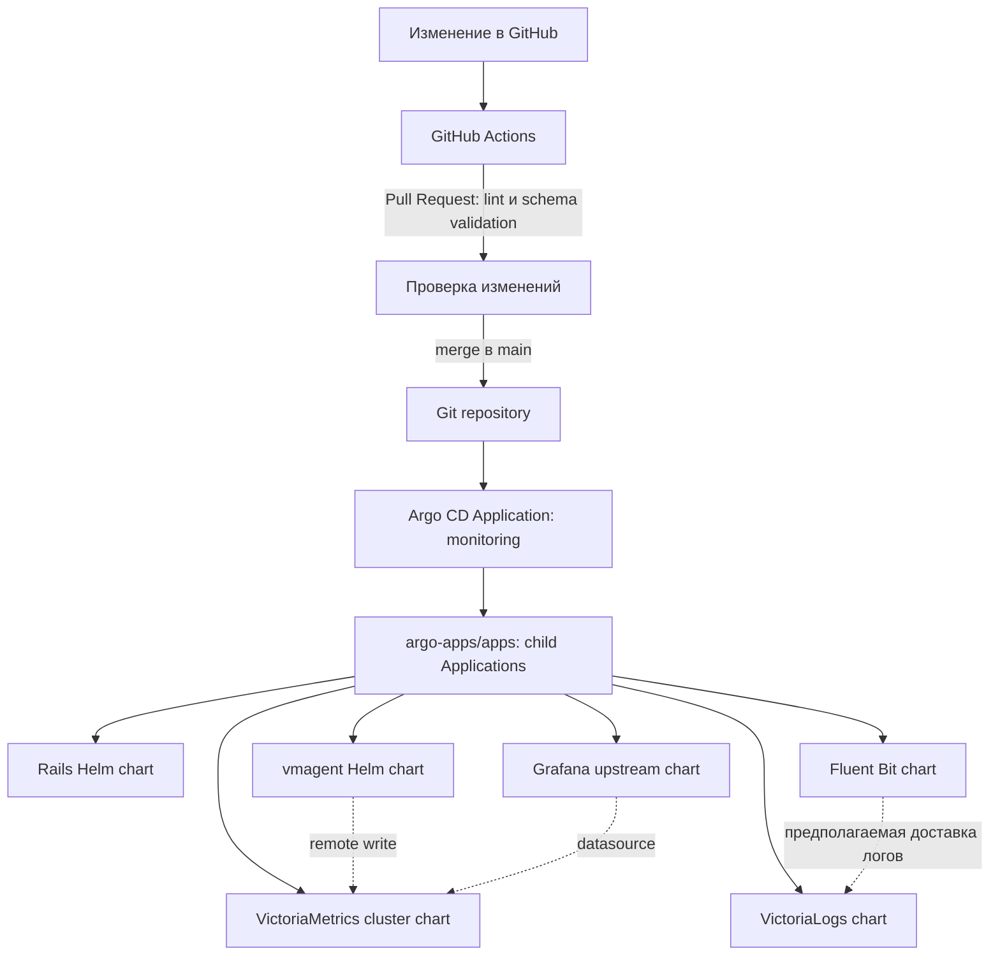

# Monitoring GitOps for Rails

Репозиторий описывает GitOps desired state для Rails-приложения и monitoring stack в Kubernetes. Argo CD синхронизирует Application manifests из Git; Helm рендерит дочерние приложения. README описывает конфигурацию репозитория, но сам по себе не подтверждает, что ресурсы сейчас развернуты или healthy в кластере.

## Архитектура



`argo-apps/monitoring.yaml` — корневое Argo CD Application (App of Apps). Оно читает `argo-apps/apps/`, где лежат дочерние Applications. Дочерние приложения разворачиваются в namespace `monitoring`; само приложение `monitoring` и дочерние Argo CD Applications размещаются в `argocd`. Для локальных charts указан Git URL этого репозитория, для остальных — upstream Helm repositories.

| Application | Источник | Закреплённая версия / путь |
| --- | --- | --- |
| `monitoring` | Git path | `argo-apps/apps` |
| `rails-app` | Локальный Helm chart | `charts/rails-app` |
| `vmagent` | Локальный Helm chart | `charts/vmagent` |
| `grafana` | `grafana/helm-charts` | `9.2.7` |
| `fluent-bit` | `fluent/helm-charts` | `0.22.0` |
| `victorialogs` | `victoriametrics/helm-charts` | `0.11.3` |
| `victoriametrics` | `victoriametrics/helm-charts` | `0.11.8` |

Argo Applications используют автоматическую синхронизацию, prune и self-heal. Конфигурация Argo CD как платформы не хранится в этом репозитории: здесь нет манифестов установки Argo CD.

## Компоненты и границы

- **Rails** — Deployment и ClusterIP Service создаёт `charts/rails-app`. Chart ссылается на образ `maxkerim/rails-app:latest`; сборка и публикация образа в GitHub Actions не настроены.
- **vmagent** — локальный chart читает scrape config из ConfigMap, опрашивает статическую цель Rails каждые 15 секунд и отправляет данные в VictoriaMetrics.
- **VictoriaMetrics** — upstream cluster chart принимает remote write через `vminsert`; чтение метрик выполняется через `vmselect`.
- **Grafana** — upstream chart, пароль администратора берётся из Kubernetes Secret `grafana-admin`. Datasource объявлен inline в `argo-apps/apps/grafana.yaml`.
- **Fluent Bit / VictoriaLogs** — оба объявлены Argo Applications на upstream charts. Сам факт наличия этих Applications не означает, что поток логов работает; см. известные ограничения ниже.

Все текущие Services настроены как `ClusterIP`. В репозитории **нет** ресурсов Ingress, Ingress NGINX, cert-manager, `Issuer`/`ClusterIssuer`, DNS names или TLS certificates. Если кластер использует эти компоненты, они устанавливаются и настраиваются отдельно; внешний доступ к Grafana или Rails этим репозиторием не определён.

Каталог `apps/rails-app/` содержит Rails-код и отдельные Kubernetes manifests с Kustomize (`kustomization.yaml`). Текущий Argo App-of-Apps их не применяет: для `rails-app` источником служит Helm chart `charts/rails-app`.

## Предварительные требования

- Kubernetes cluster и `kubectl` с доступом к нему.
- Argo CD уже установлен, namespace `argocd` создан, Git repository доступен Argo CD.
- Namespace `monitoring` и необходимые Secrets созданы до синхронизации приложений.
- Rails image `maxkerim/rails-app:latest` опубликован в доступном registry.
- Для production — secret manager, TLS/Ingress и storage, настроенные согласно требованиям кластера. Они не provisioned этим репозиторием.

## Bootstrap и процесс деплоя

Создайте namespace и Secrets до установки корневого Application. Введите Rails key и Grafana password из своего secret store; значения вводятся скрыто и не должны попадать в shell history или Git:

```sh
kubectl create namespace monitoring --dry-run=client -o yaml | kubectl apply -f -

read -rsp 'Rails master key: ' RAILS_MASTER_KEY && echo
kubectl -n monitoring create secret generic rails-app-master-key \
	--from-literal=master-key="$RAILS_MASTER_KEY" \
	--dry-run=client -o yaml | kubectl apply -f -
unset RAILS_MASTER_KEY

read -rsp 'Grafana admin password: ' GRAFANA_ADMIN_PASSWORD && echo
kubectl -n monitoring create secret generic grafana-admin \
	--from-literal=admin-user=admin \
	--from-literal=admin-password="$GRAFANA_ADMIN_PASSWORD" \
	--dry-run=client -o yaml | kubectl apply -f -
unset GRAFANA_ADMIN_PASSWORD

kubectl apply -f argo-apps/monitoring.yaml
```

После bootstrap процесс выглядит так:

1. Изменение открывается в Pull Request. GitHub Actions запускает chart lint и проверку отрендеренных Kubernetes manifests.
2. После merge в `main` Argo CD сравнивает Git state с кластером.
3. Корневой Application синхронизирует YAML из `argo-apps/apps/` и создаёт child Applications.
4. Child Applications загружают локальные charts или закреплённые версии upstream charts и применяют их в `monitoring`.
5. При включённых sync policy Argo CD автоматически применяет изменения, удаляет ресурсы, исчезнувшие из desired state (`prune`), и исправляет drift (`selfHeal`).

Workflow **не** собирает Rails image и не устанавливает Kubernetes, Argo CD, Ingress NGINX или cert-manager.

## Проверка кластера

Команды ниже дают runtime evidence из кластера. Они требуют настроенного kube-context:

```sh
kubectl config current-context
kubectl -n argocd get applications.argoproj.io -o wide
kubectl -n argocd get application monitoring -o yaml
kubectl -n monitoring get pods -o wide
kubectl -n monitoring get svc
```

Для локального просмотра Grafana в текущей конфигурации chart создаёт Service `grafana` на порту 80:

```sh
kubectl -n monitoring port-forward svc/grafana 3000:80
```

Откройте `http://localhost:3000` и войдите пользователем `admin` с паролем, переданным в Secret `grafana-admin`. В репозитории нет dashboard JSON provisioning; пользовательский Grafana dashboard не подтверждён как созданный или работающий. Скриншот или состояние Argo CD следует добавлять только после получения из реального кластера.

## Проверенные ограничения конфигурации

Перед тем как считать metrics/logs pipeline рабочим, исправьте и проверьте endpoints в manifests. Pinned upstream chart renders показывают:

- VictoriaMetrics cluster `0.11.8` создаёт `victoriametrics-victoria-metrics-cluster-vminsert` и `...-vmselect`. `charts/vmagent/values.yaml` использует для remote write короткое имя `victoria-metrics-cluster-vminsert`, а Grafana datasource указывает на `victoriametrics-victoria-metrics-single-server:8428`; эти имена не совпадают с отрендеренными Service.
- VictoriaLogs `0.11.3` создаёт `victorialogs-victoria-logs-single-server` на порту `9428`. Fluent Bit Application передаёт `backend.forward` к `victorialogs:24224`, но этот адрес не совпадает с отрендеренным VictoriaLogs Service. Кроме того, текущие values не заменяют upstream chart output: render по умолчанию содержит Elasticsearch outputs.
- vmagent настроен на scrape `rails-app.monitoring.svc.cluster.local:3000`; успешное scrape и наличие Rails metrics endpoint проверяются только в работающем кластере.

Поэтому этот README документирует declared configuration и проверяемые предпосылки, а не утверждает, что dashboards, метрики, логи, Ingress или TLS уже работают.

## CI и локальные проверки

`.github/workflows/validate.yaml` запускается для каждого Pull Request, а также при push в `main`. Он выполняет:

- `helm lint` для локальных charts из `charts/` и upstream Grafana `9.2.7`;
- `helm template` и `kubeconform` для локальных charts и Grafana;
- `kubeconform` для Argo CD Applications. Схемы custom resources Argo CD пропускаются через `-ignore-missing-schemas`.

Локальная проверка локальных charts:

```sh
for chart in charts/*; do
	if [ -f "$chart/Chart.yaml" ]; then
		helm lint "$chart"
		helm template "$(basename "$chart")" "$chart"
	fi
done
```

## Структура репозитория

```text
.
├── .github/workflows/validate.yaml  # PR/push checks
├── apps/rails-app/                  # Rails app, Dockerfile, Kustomize manifests
├── argo-apps/
│   ├── monitoring.yaml              # root App-of-Apps
│   └── apps/                        # child Applications
├── charts/
│   ├── rails-app/                   # Rails Deployment и Service
│   └── vmagent/                     # scrape config, Deployment и Service
├── config/puma.rb
├── LICENSE
└── README.md
```

## Лицензия

Проект распространяется по лицензии MIT. См. [LICENSE](LICENSE).
